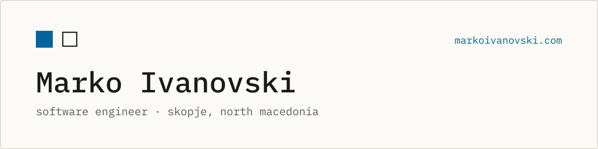

<a href="https://markoivanovski.com">
  <picture>
    <source media="(prefers-color-scheme: dark)" srcset="assets/banner-dark.svg" />
    <source media="(prefers-color-scheme: light)" srcset="assets/banner-light.svg" />
    
  </picture>
</a>

I design and build reliable software, from the first idea to production.

I'm a full-stack software engineer based in Skopje. I build web applications and data-driven tools,
and I care about software that's fast, well tested and easy to grow. Every project has a written
case study on [markoivanovski.com](https://markoivanovski.com).

### What I do

| | |
| --- | --- |
| **Web applications** | Full-stack web apps on modern frameworks, from the database to the interface. |
| **Data and machine learning** | Pipelines, analysis and models measured against a clear baseline. |

### Experience

```text
Endava   Software Engineering Internship   Jul 2026 – Aug 2026
MASA     Student Researcher                Feb 2026 – Jun 2026
ASEE     Software Engineering Internship   Jul 2024 – Sept 2024
```

### Education

```text
2022 – now   Ss. Cyril and Methodius University, Skopje   BSc, Computer Science and Engineering
2022 – 2023  Brainster                                    Full-Stack Development Bootcamp
```

### Stack

| | |
| --- | --- |
| **Languages** |      |
| **Back-end** |       |
| **Front-end** |    |
| **Data** |      |
| **Machine learning** |    |
| **Delivery** |      |
